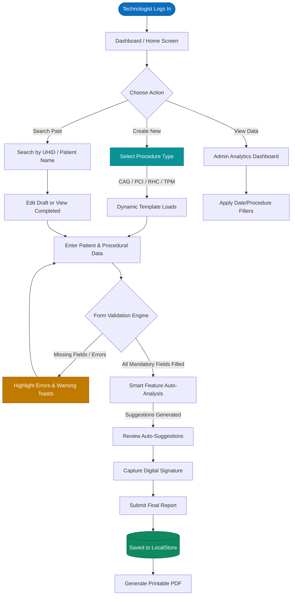
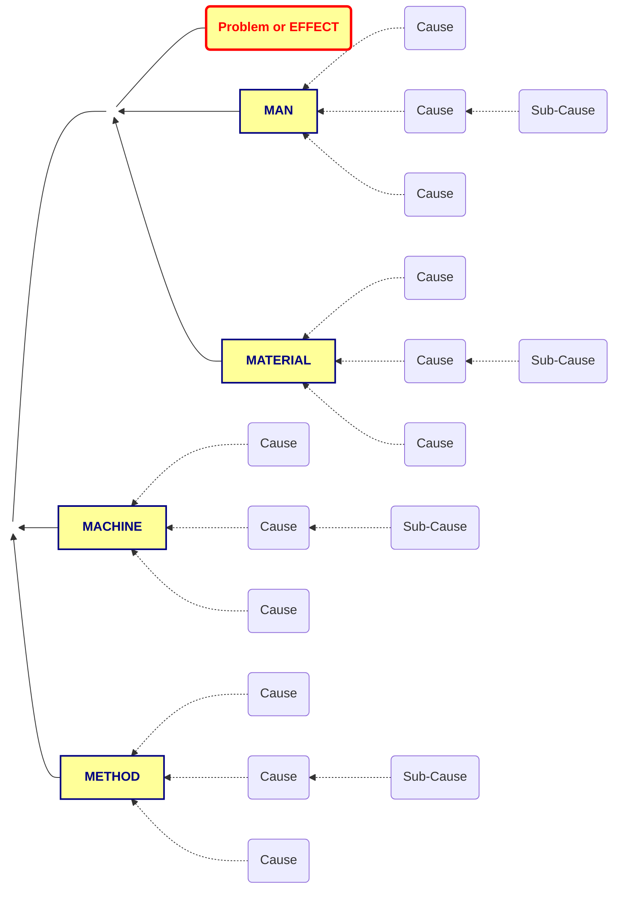

# CathLab Pro – Architecture & Workflow Diagrams

This document contains visual representations of the system architecture and user workflows for the **CathLab Pro** application, generated using Mermaid diagrams.

---

## 1. Application Flow Diagram
This flowchart describes the end-to-end journey of a cardiovascular technologist using the application to record and finalize a reporting procedure.

---

## 2. System "Fishbone" Diagram (Ishikawa)
This fishbone diagram illustrates the contributing components that enable the core goal of **CathLab Pro**: Generating standardized, accurate, and medical-grade digital reports.

---

*Note: You can view these diagrams natively if you push to GitHub, as GitHub natively renders `mermaid` code blocks in Markdown files.*
